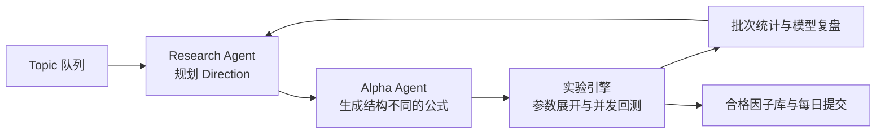

# WorldQuant Alpha 自动化研究系统

一个面向 WorldQuant BRAIN 的自主 Alpha 研究工作流。研究员可以通过对话提出研究主题；系统将主题排队后，自动完成假设生成、FASTEXPR 公式构建、参数实验、回测复盘、因子组合与合格因子提交。

## 研究流程



- **分层研究**：以 Topic → Direction → Experiment 组织假设，保留每个批次的公式、参数、结果和研究结论。
- **批量实验**：模型选择 1～2 个参数及候选值，程序逐维展开，按配置并发调用 BRAIN，并根据限流响应退让。
- **结果驱动的迭代**：模型分析同一因子族的跨批次结果，给出优化方向与新公式。显著负 Sharpe 的公式会先反向回测，再依据真实结果继续研究。
- **双因子组合**：在同一 Direction 内配对因子，测试固定权重；记录 Fitness 改善情况，连续两次未改善的因子停止参与新组合。
- **可追溯提交**：合格因子与失败实验均持久化；北京时间每天最多正式提交一个因子，同一基础因子不能重复以单因子或组合形式提交。

研究决策由模型负责；参数替换、去重、预算、平台请求和状态恢复由程序负责。模型可使用 OpenAI、DeepSeek 或兼容接口，系统提示词以独立文件管理。

## 快速开始

需要 Python 3.11+。在项目根目录复制并填写配置：

```powershell
if (-not (Test-Path research_workflow\config.env)) {
    Copy-Item research_workflow\config.env.example research_workflow\config.env
}
python -m research_workflow
```

运行期间，可在另一个终端与 Agent 讨论新 Topic：

```powershell
python -m research_workflow chat
```

输入 `/queue` 将当前讨论草案加入队列。正在研究的 Topic 会完成后再执行下一个；人工 Topic 优先。也可以直接运行 `python -m research_workflow topic add "研究主题"`。

配置项和命令说明见 [运行手册](research_workflow/README.md)，模型交互和流程图见 [工作流说明](research_workflow/WORKFLOW.md)。

如需用项目已有的模型密钥启动本机 Codex CLI，见 [Codex CLI 使用说明](CODEX_CLI.md)。
