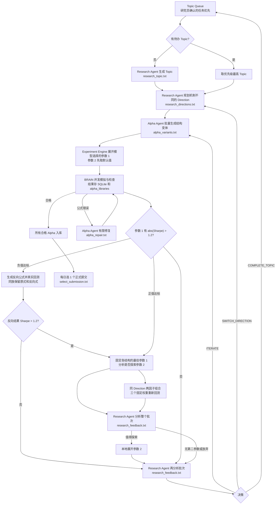

# WorldQuant 自主研究工作流

默认命令 `python -m research_workflow` 使用 Topic → Direction → Experiment 的分层流程。Research Agent 负责主题、方向和批次结论，Alpha Agent 负责公式结构与错误修复；确定性程序负责参数替换、去重、预算、BRAIN 调用、并发轮询和落盘。两者是轻量模型接口，不依赖 RD-Agent 或多 Agent 框架。另一个终端可运行 `python -m research_workflow chat` 与研究员多轮讨论；确认后的人工 Topic 入库，当前 Topic 完成后再按优先级选取，不抢占。

图中的反馈调用在参数 1 阶段决定是否探索第二个参数，也可直接完成 Direction/Topic 决策。`ITERATE` 最多执行 `ALPHA_MAX_EXPERIMENTS_DIRECTION` 个实验批次；连续 `ALPHA_FAMILY_MAX_STAGNANT` 个批次没有改善时强制切换 Direction。改进优先看通过率，其次看 Sharpe 中位数，最后看最高 Sharpe。所有候选结果都会进入统计。

## 模型交互与提示词

每次模型调用重新读取对应 UTF-8 提示词文件作为 system message；当前 Topic、Direction、同批次结果和相关历史作为 JSON user message。没有隐式对话会话。

| 阶段 | 默认提示词 | JSON 输入 | JSON 输出 |
| --- | --- | --- | --- |
| 运行时独立讨论 `topic_brainstorm` | [topic_brainstorm.txt](prompts/topic_brainstorm.txt) | 已持久化的研究员与 Agent 讨论历史、目标设置、最近主题 | 简短答复和 Topic 草案；研究员 `/queue` 后才入队 |
| 队列为空 `research_topic` | [research_topic.txt](prompts/research_topic.txt) | 默认研究目标、最近 Topic 和反馈 | `title`、`objective`、`rationale` |
| 新 Topic `research_directions` | [research_directions.txt](prompts/research_directions.txt) | Topic、最多方向数、最近反馈 | `directions[]`：名称、假设、机制 |
| 新实验 `alpha_variants` | [alpha_variants.txt](prompts/alpha_variants.txt) | Topic、Direction、实验目标、上轮反馈、BRAIN 设置、数量 | 结构不同的 `hypothesis`、FASTEXPR 模板、模型选择的 1～2 个参数及候选值 |
| 公式错误 `alpha_repair` | [alpha_repair.txt](prompts/alpha_repair.txt) | 原假设、公式、平台错误、修复次数、设置 | 修正假设、公式、理由 |
| 批次反馈 `research_feedback` | [research_feedback.txt](prompts/research_feedback.txt) | 当前 Topic/Direction/Experiment、同族原式和反向式、全批次公式与结果、预算 | `EXPLORE_PARAM2` / `ITERATE` / `SWITCH_DIRECTION` / `COMPLETE_TOPIC`；`ITERATE` 同时返回优化方向、1～2 个新假设及 FASTEXPR 模板和父候选 ID |
| 每日提交 `submission_selection` | [select_submission.txt](prompts/select_submission.txt) | 所有符合条件且未提交的候选审阅批次 | 一个候选 ID 和理由 |
| 可选连通性检查 `connectivity_check` | [probe.txt](prompts/probe.txt) | 最小测试请求 | `{"ok":true}` |

旧版 `run <run_id>` / `once <run_id>` 仍使用 [generate.txt](prompts/generate.txt)、[decide.txt](prompts/decide.txt)、[parameter_decide.txt](prompts/parameter_decide.txt)；默认自主流程不调用它们。

## 批次评价与持久化

`batch_statistics` 汇总候选数量、状态/通过率、Sharpe/Fitness/Returns/Turnover 的最小值、中位数、均值、最大值、结构和参数值分组，以及失败检查项。只有 BRAIN 返回了相关性数值，才把它作为证据；缺失时标记 `unavailable`。研究判断及其输入统计写入 SQLite 的 `feedback` 表。

SQLite 保存 `topics`、`directions`、`experiments`、`feedback`、`candidates`、提交占位和服务冷却。每个候选 JSON 包含 Topic/Direction/Experiment ID、假设、公式、参数、状态、平台结果和修复链。通过检查或提交的 Alpha 继续写入 `alpha_libraries/wq_<alpha_id>.md`；所有合格 Alpha 继续列在 `eligible_alphas.json`，标记是否提交。北京时间每日正式提交数由数据库唯一约束限制为 1。

`WARNING` 且有 Alpha ID 时继续读取平台详情；平台还没有指标就继续轮询。限流或次数上限按 BRAIN 返回的退让时间处理。本地每日模拟预算和并发数仍由配置控制。一个进程负责所有 Topic 的调度，避免多个 worker 重复提交。
