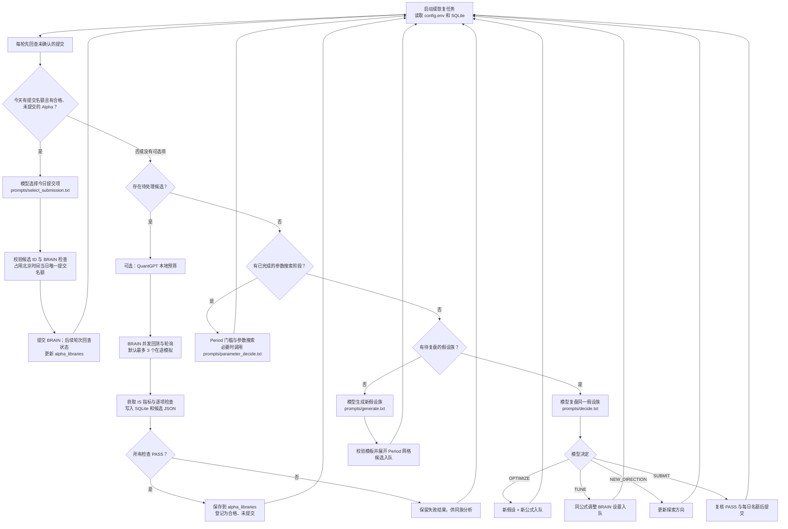
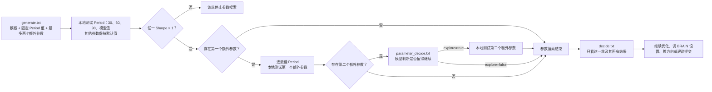

# 因子研究工作流与模型交互

日常执行 `python -m research_workflow`：自动创建或恢复研究任务，然后循环推进。`python -m research_workflow probe` 是可选的模型连通性测试，不参与研究循环。

## 主流程

图中每条返回“启动或恢复任务”的边表示进入下一轮调度，不会重新创建任务。一次调度可能并行推进多个 BRAIN 模拟；模型调用和 HTTP 请求按程序顺序发起。服务返回限流时，冷却时间写入 SQLite，后续轮次再继续。

`_submit_eligible` 在每轮处理候选前运行，所以已经合格的 Alpha 可以先进入“今日提交选择”。`decide.txt` 的 `SUBMIT` 是另一条提交建议路径；两条路径都经过提交前 BRAIN 复核与数据库中的每日唯一名额约束。所有通过检查的 Alpha 都保留在库中，未被当日选中的仍标记为未提交。

## 五类模型调用

每次模型调用都把对应文件的内容作为 **system prompt**，把下表的上下文编码成单独的 **JSON user 消息**。调用后先解析 JSON，再做本地字段、类型和目标候选校验。模型不能直接调用 BRAIN；它只能给出候选或判断，由工作流执行。

| 调用时机 / 日志 `stage` | 默认 system prompt | JSON 输入重点 | 要求的 JSON 输出 | 工作流随后做什么 |
| --- | --- | --- | --- | --- |
| 新一轮生成 / `alpha_candidates` | [prompts/generate.txt](prompts/generate.txt) | `objective`、`direction`、`requested_count`、BRAIN `settings`、本任务最近 **30** 个候选的 `history` | `candidates[]`：每项含 `hypothesis`、`expression_template`、`period`（`name=Period` 和一个固定 `default`）、`parameters`（0～2 个，各含名称、默认值、离散值列表） | 校验模板、去重；本地替换占位符并建立参数搜索候选。历史用于避免重复，不表示会同时优化 30 个族。 |
| 同一假设族复盘 / `research_decision` | [prompts/decide.txt](prompts/decide.txt) | `objective`、`direction`、`family_id`、最新候选 ID、连续未改善次数、**该族完整** `history`、今日提交名额和剩余模拟预算 | `action`=`NEW_DIRECTION` / `OPTIMIZE` / `TUNE` / `SUBMIT`，以及 `reason`、`target_id`、`next_direction`、`parameter_changes`、`optimized_hypothesis`、`optimized_expression` | 校验 `target_id` 属于本族；优化时直接保存新的假设和公式，调参时保存新 BRAIN 设置；提交时再次检查资格。 |
| 决定是否探索第三维 / `parameter_decision` | [prompts/parameter_decide.txt](prompts/parameter_decide.txt) | `family_id`、该族完整 `history`、已选参数值、待探索的第二个额外参数及其候选值、剩余模拟预算 | `{"explore": true/false, "reason": "..."}` | `true` 时本地生成第三维候选；`false` 时结束参数搜索。 |
| 选择当日一个提交项 / `submission_selection` | [prompts/select_submission.txt](prompts/select_submission.txt) | `eligible`：合格且未提交的 Alpha 审阅批次；`today_submission_used=false` | `{"target_id": "候选ID", "reason": "..."}` | 确认 ID 在本次审阅批次内，再复核 BRAIN 并尝试占用当日名额。审阅批次由 `ALPHA_SUBMISSION_REVIEW_LIMIT` 限制，其他合格 Alpha 继续保留。 |
| 手动执行 `probe` / `connectivity_check` | [prompts/probe.txt](prompts/probe.txt) | `{"task":"connectivity check"}` | `{"ok":true}` | 只验证模型通路，不连接 BRAIN，也不启动研究。 |

默认路径由 [config.py](config.py) 指定。可直接修改上述 UTF-8 文件；程序在**每一次模型调用前重新读取**文件。也可在 `config.env` 中用 `LLM_GENERATE_PROMPT_FILE`、`LLM_DECIDE_PROMPT_FILE`、`LLM_PARAMETER_PROMPT_FILE`、`LLM_SUBMISSION_PROMPT_FILE`、`LLM_PROBE_PROMPT_FILE` 分别指向自定义文件。`python -m research_workflow check` 会列出当前生效的路径。每次调用的日志记录提示词路径及内容哈希，便于确认实际版本。

## 假设族如何迭代

`Period` 候选由 `ALPHA_PERIOD_GRID`（默认 `30,60,90`）加上模型给出的固定值组成，去重后逐项回测。只有 Period 阶段存在 Sharpe **严格大于 1** 的结果，才进入后续参数维度。其余参数搜索由代码渲染模板并排队回测，**不会为每个参数值再调用一次模型**。只有决定是否探索第三维时使用 `parameter_decide.txt`。

假设族 `history` 从 SQLite 按父候选关系组装，包含候选 ID、假设、公式、BRAIN 设置、参数值、状态、Sharpe、Fitness、Returns、Turnover、逐项检查和错误。模型可用 `target_id` 精确指定要改进的候选；`OPTIMIZE` 返回的新假设和新公式会记录父候选 ID。连续 `ALPHA_FAMILY_MAX_STAGNANT` 次（默认 5 次）新优化或调参候选未改善 BRAIN 检查时，代码停止该族，继续研究其他方向。

模型调用之间没有服务端对话会话；上下文来自每次重新构造的 JSON。模型输出格式错误时会记录原因并冷却，不会把这次无效输出作为新候选送去 BRAIN 回测。

## 结果与运行记录

- SQLite 保存任务、候选、模型复盘决策、参数搜索阶段、冷却时间和提交占位。
- `alpha_libraries/candidates/<candidate_id>.json` 保存每个已接收候选的假设、公式、参数、状态和回测结果；未通过的结果也保留。
- `alpha_libraries/wq_<alpha_id>.md` 保存通过 BRAIN 检查或已提交的 Alpha 思路、公式和结果；`eligible_alphas.json` 汇总资格与提交状态。
- 控制台和 `research_workflow/logs/workflow.log` 记录方向、模型调用阶段、提示词文件哈希、回测指标、逐项检查及提交状态。文件日志还保存 DEBUG 级别的模型输入输出。

完整配置和启动命令见 [README.md](README.md)。
